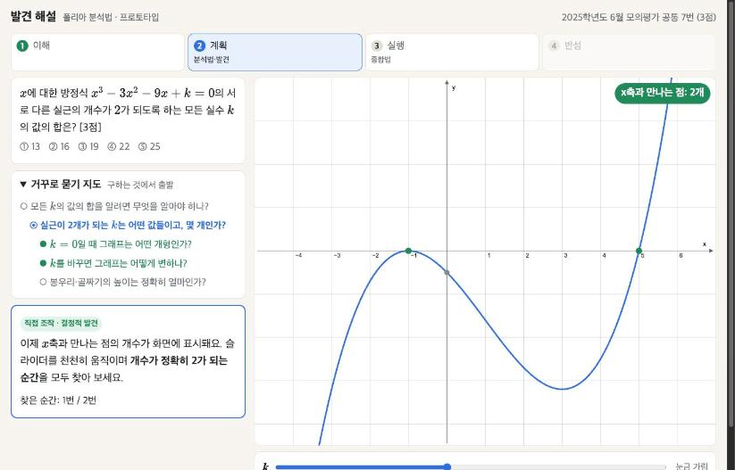
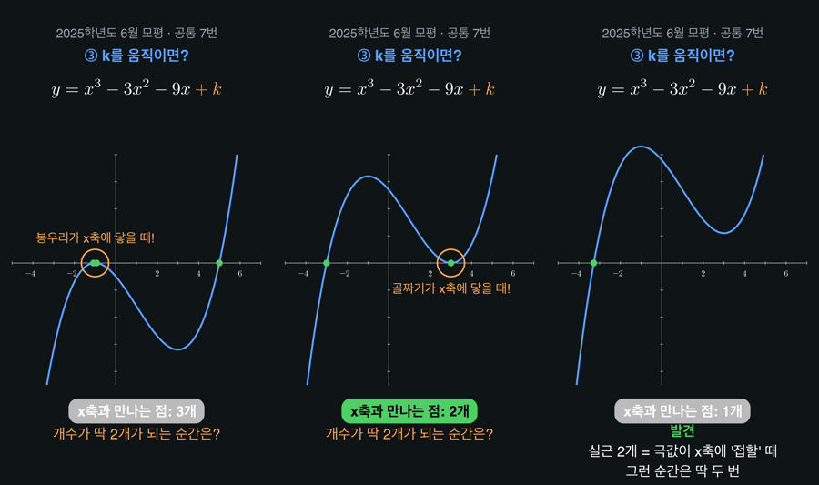

# 아침 보고 — 2026-10-28

선생님 주무시는 동안 한 일, 보실 것, 확인해 주실 것을 정리했어요.

## 1. 바로 보실 결과물

| 결과물 | 위치 | 보는 법 |
|---|---|---|
| **인터랙티브 해설 프로토타입** (2025 6월 모평 7번) | `app/` | 아래 명령으로 서버를 켜고 http://localhost:8790 접속 |
| **쇼츠 시안 영상** (같은 문항, 1080×1920, 51초) | `shorts/out/s01_2025_6월모평_7.mp4` | 파일 더블클릭 |
| 발견 그래프 **스키마 v1** | `docs/schema-v1.md` | |
| 7번 문항 v1 데이터 + 검사기 | `data/graphs/v1/` | 검사 22/22 통과 |

```bash
cd ~/Documents/howtosolveit && .venv/bin/python -m http.server 8790 --directory app
```



## 2. 프로토타입에서 학생이 거치는 길

선생님 블로그 해설의 흐름(구하는 것 먼저 보기 → 조건 뜯어보기 → 손으로 먼저 → 확인)을 그대로 단계로 만들었어요.

1. **이해** — "모든 *k*의 **합**"이 무엇을 암시하는지 먼저 생각하고, 조건을 *내 말로* 바꿔 쓴 뒤 모범 요약과 비교해요.
2. **계획(분석법·발견)**
   - **개형 예측(딸깍 금지):** 곡선은 처음에 보이지 않아요. 학생이 캔버스에 **손으로 개형을 그려야** 열려요. 스케치에서 극값 개수와 양 끝 방향을 자동으로 읽어 판정하고, 틀리면 힌트가 나와요. 두 번 틀리면 정답을 알려 주지 않고 곡선을 열어 *내 스케치(점선)와 비교*하게 해요.
   - *k*를 바꾸면? → 보기 중에서 고르는 예측 → 슬라이더 조작 → 알아차린 것 쓰기
   - 교점 개수 순서 예측(예: 1,3,1) → **결정적 발견:** 슬라이더로 "개수가 정확히 2가 되는 순간"을 두 번 찾기 → 내가 쓴 것 vs 알아차릴 것 비교 (내 예측 1→3→1 vs 실제 1→2→3→2→1)
3. **실행(종합법)** — 이제야 극값을 계산하고, *k*=−5, 27과 합 22를 입력해요. **슬라이더 눈금은 *k*를 계산으로 구한 뒤에야 열려요**(눈금 읽기로 계산을 건너뛰는 것 방지). 마지막에 해설지 모양의 종합법 풀이가 나와요.
4. **반성** — 말씀대로 이번에는 비활성으로 두었어요.

브라우저에서 처음부터 끝까지 직접 진행해 확인했어요. *k*=−5와 27에서만 "2개"가 나오고, 다른 값에서는 1개 또는 3개가 나와요.

## 3. 쇼츠 시안

'수학 고양이'처럼 세로형·시각화 중심으로 만들고, 순서는 폴리아 단계를 따랐어요.
훅("공식부터 쓰지 말고 그래프를 움직여 보자") → ① 구하는 것부터 → ② 보기 전에 개형 떠올리기(3·2·1 카운트) → ③ *k*를 움직여 "봉우리/골짜기가 x축에 닿을 때!" 발견 → ④ 이제야 계산 → 마무리("해설지의 한 줄 뒤에 숨은 발견").



- 앱과 영상은 같은 문항 데이터에서 출발했지만, 영상 코드(`shorts/s01_2025_6_7.py`)는 아직 손으로 썼어요. 장면 JSON에서 Manim 코드를 자동으로 만드는 건 다음 단계예요.
- 내레이션·음성과 배경음은 넣지 않았어요.

## 4. 스키마 v1 핵심 (v0 대비)

- **분석 트리와 학생의 길 분리** — `analysis`(거꾸로 묻기 지도)와 `path`(실제 단계 순서)를 따로 둬요.
- **누설 통제를 `reveal` 하나로** — 곡선, 슬라이더 눈금, 보조점, 힌트를 모두 "어느 단계 뒤에 열리는가"로 적어요.
- **`explore` 뒤에는 반드시 `notice`** — 학생이 먼저 쓰고 모범 문장을 봐요(발견 뒤 딸깍 방지).
- **블로그 문체 반영** — 조건별 `digest`("(가)의 결론은…"), `deferred`/`recall`(못 쓴 조건을 미뤘다가 회수), `unknown_hint`(구하는 값의 형태에서 힌트 읽기)를 넣었어요.
- **predict 판정 어휘 고정** — `shape`(손 스케치), `sequence`, `count`, `choice`, `sign-table`, `value`
- **빌드 시 누설 검사** — 곡선 공개 순서, 눈금 공개 시점, 정답값이 문구에 섞였는지, explore 다음에 notice가 오는지를 검사해요.

## 5. 어젯밤 받은 자료

- 평가원 2025~2027학년도 6월·9월 모평과 수능의 문제지·정답표: `data/raw/`
- EBS 해설지 8권: 풀서비스에서 받았어요. 수식이 이미지로 들어 있어서 텍스트 추출은 안 돼요.
- 수학II·미적분 133문항 목록(`data/problems/all.json`)과 선별 30문항(`docs/selection.md`)
- 파일럿 7문항 드라이런 결과: `docs/pilot-findings.md`

## 6. 확인해 주실 것

1. **개형 스케치 판정이 적절한지** — 지금은 극값 개수와 양 끝 방향만 봐요. 원점을 지나는지, 원점에서 감소하는지까지 엄격하게 볼지 정해 주세요.
2. **"생각할 시간"을 주는 방식** — 앱은 예측을 *입력*해야 넘어가고, 영상은 3초 카운트만 있어요. 쇼츠에서 더 강하게 멈추게 할지(예: "일시정지하고 그려 보세요" 자막) 정해 주세요.
3. **쇼츠 톤** — '수학 고양이'처럼 캐릭터나 내레이션을 넣을지, 지금처럼 자막만 쓸지 정해 주세요.
4. 블로그 해설 중 **앱으로 먼저 옮기고 싶은 문항**이 있는지 알려 주세요(예: 22학년도 수능 22번).

## 7. 다음 단계 제안

1. 파일럿 2·3번 패턴(2026 수능 15번 조각함수·가로지르기, 2027 6월 15번 param-set)을 v1로 옮겨 렌더러에 객체 타입을 추가하기
2. 장면 JSON → Manim 코드 자동 생성기 만들기 (앱과 쇼츠를 한 데이터에서)
3. 교육청 학력평가 자료 수집하기 (EBSi 풀서비스 같은 경로로 가능해 보여요)
